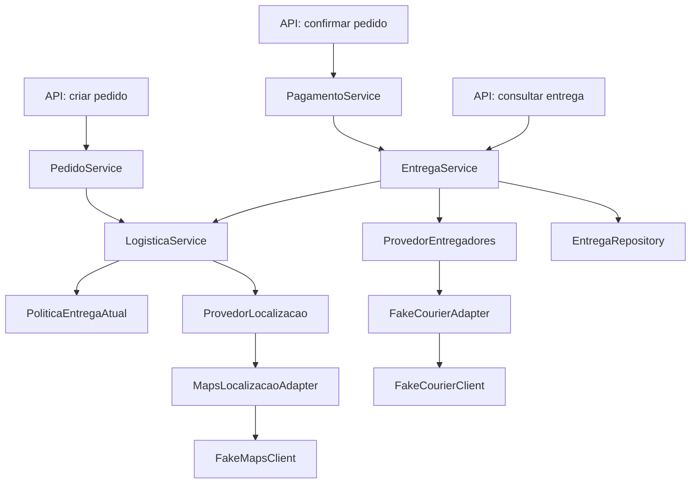

# Atividade 06 — Refatoração do FoodNow

**Integrante(s):** [COLOCAR NOME(S)]  
**Disciplina:** Arquitetura de Software

## O que eu entendi da atividade

O objetivo é melhorar a organização do código sem mudar o resultado que o usuário recebe. Se antes um pedido tinha uma taxa de entrega e um tempo previsto, depois da refatoração esses valores devem continuar iguais para as mesmas informações.

Eu usei como ponto de partida o projeto disponibilizado e a solução de referência da atividade. **Essa base já possuía `LogisticaService`, `PoliticaEntregaAtual`, `ProvedorLocalizacao`, `MapsLocalizacaoAdapter` e `NotificacaoService`.** Portanto, não estou dizendo que criei essas partes. A alteração adicional neste trabalho foi separar a chamada do simulador de entregadores da classe `EntregaService`, com testes para verificar o comportamento.

## 1. Pontos do código que analisei

| Classe / método | O que faz e de que depende | Problema e efeito de uma mudança |
| --- | --- | --- |
| `PedidoService.criar` | Busca cliente, restaurante, endereço e produtos nos repositórios e usa `LogisticaService` | Reúne várias etapas. Alterar a cotação pode interferir na criação do pedido. |
| `LogisticaService.cotarPedido` | Pede dados de rota ao `ProvedorLocalizacao` e chama a política de entrega | A criação do pedido depende do resultado desta cotação. |
| `PoliticaEntregaAtual.cotarPedido` | Consulta cliente, restaurante, endereço, rota e `TaxaEntregaUtil` para decidir atendimento e taxa | Alterações na distância ou na região podem mudar se um pedido é aceito e quanto custa. |
| `PoliticaEntregaAtual.adicionalDosItens` | Calcula o adicional regional e faz arredondamento | Um arredondamento diferente pode mudar o valor final em centavos. |
| `PoliticaEntregaAtual.planejarEntrega` | Define distância, zona e tempo usados para o despacho | Mudar esses valores pode afetar o tempo apresentado e a disponibilidade de entregador. |
| `PoliticaEntregaAtual.resumirPedido` | Prepara informações de região e prazo usadas em outros fluxos | Alguns cálculos parecidos têm resultados diferentes; não é seguro juntar tudo sem testes. |
| `MapsLocalizacaoAdapter.calcularRota` | Usa `FakeMapsClient` e transforma o resultado em `Rota` | Se mudar o simulador de mapas, o adaptador precisará de ajustes, mas outros serviços ficam menos afetados. |
| `EntregaService.criarPara` | Usa `LogisticaService`, despacha entregador e salva pelo `EntregaRepository` | Havia dependência direta do `FakeCourierClient`. Foi o ponto escolhido para minha refatoração adicional. |
| `PagamentoService.processar` | Interage com o pagamento e outros serviços, incluindo entrega e notificação | Mudanças nesse fluxo podem afetar vários estados e ações. |
| `Endereco.classificarZonaDeEntrega` | Usa informações do endereço para classificar a zona | A regra de região ainda está espalhada e pode precisar de revisão no futuro. |

Os pontos acima envolvem **services, modelo/domínio, utilitário, integração e persistência**.

## 2. Fluxo principal e dependências



De maneira simplificada: **criar pedido → confirmar → pagar → criar/consultar entrega**. O pagamento, quando autorizado, participa do fluxo que gera a entrega.

## 3. O que foi organizado

Na base de referência já havia uma separação importante: `LogisticaService` coordena o cálculo, `PoliticaEntregaAtual` reúne regras de distância, taxa e região, e `ProvedorLocalizacao` evita que os serviços precisem usar diretamente o simulador de mapas. Isso ajuda a atender ao objetivo da atividade, mas **não é uma mudança nova feita neste pacote**.

A alteração adicional foi na parte dos entregadores. Antes, `EntregaService` conhecia `FakeCourierClient` e os tipos próprios dele. Agora:

- `ProvedorEntregadores` é uma interface com o que o serviço precisa para solicitar um entregador.
- `FakeCourierAdapter` recebe esse pedido, chama `FakeCourierClient` e devolve uma resposta num formato usado pela aplicação.
- `EntregaService` usa a interface e não precisa conhecer os tipos do simulador.

Também ajustei o nome da variável usada no serviço para `provedorEntregadores`, porque descreve melhor sua função. Não alterei o cálculo de prazo, valores, endpoints ou dados salvos.

## 4. Antes e depois

| Antes | Depois |
| --- | --- |
| `EntregaService` dependia de `FakeCourierClient` | `EntregaService` depende de `ProvedorEntregadores` |
| O serviço precisava usar os tipos do simulador | `FakeCourierAdapter` faz a conversão |
| Uma troca de fornecedor de despacho atingiria o serviço | Uma troca pode ficar concentrada em outro adaptador |
| Regras de logística e abstração dos mapas já existiam na base recebida | Essas partes foram mantidas |

A vantagem é diminuir a dependência de um detalhe de integração. A desvantagem é que agora existem mais arquivos (interface e adaptador), então a estrutura fica um pouco maior.

## 5. Regra futura

O enunciado fala de uma possível taxa considerando **trajeto, região, horário e condições operacionais**. Eu **não implementei** essa regra, porque a atividade pede apenas analisar seu impacto. Uma evolução razoável seria mudar a política de logística e introduzir uma forma controlada de consultar o horário, protegendo o comportamento atual com testes.

Também não alterei regras geográficas que ainda existem em classes do modelo, o gateway de pagamento, o banco de dados e o envio de notificações. Fazer tudo isso junto aumentaria o risco de mudar resultados que já funcionam.

## 6. Testes e resultado

O projeto tem testes unitários e de integração. Foram acrescentados três testes no `FakeCourierAdapterTest`, para verificar o resultado do simulador na região central, em região urbana e quando não há entregador disponível. Os testes de API já existentes não foram modificados.

No Windows, após abrir o projeto com JDK 26 e Maven, executei:

```powershell
mvn clean verify
```

**Resultado informado pelo terminal em 16/10/2026:** `BUILD SUCCESS`; 32 testes unitários e 11 de integração; 0 falhas; 0 erros. O JaCoCo registrou **96% de cobertura de instruções** no relatório visualizado e o Maven mostrou `All coverage checks have been met`. A cobertura mínima de linhas exigida é de 80%; o próprio Maven confirmou que as verificações configuradas foram cumpridas.

Os avisos de Mockito/Byte Buddy apareceram, mas não impediram a execução dos testes.

## 7. O que eu ainda preciso compreender e conferir

Este material teve apoio de IA para analisar o código e organizar a documentação. Antes de entregar, vou conferir pessoalmente os seguintes pontos para conseguir explicá-los:

- [ ] Encontrar no `EntregaService` onde o entregador é solicitado.
- [ ] Explicar com minhas palavras o que é uma interface Java.
- [ ] Seguir a chamada de `EntregaService` até `FakeCourierAdapter` e `FakeCourierClient`.
- [ ] Abrir `FakeCourierAdapterTest` e entender um dos cenários.
- [ ] Confirmar que os testes continuam passando depois da última alteração de nome.
- [ ] Preencher meu nome e colocar o link do Pull Request.

**PR:** [COLOCAR LINK APÓS CRIAR]
