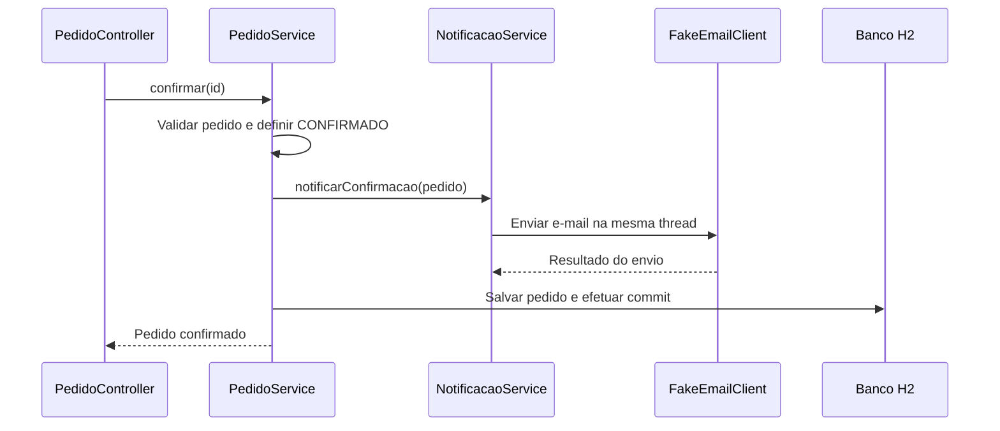
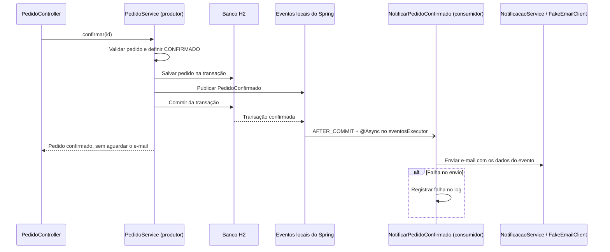

# Atividade 04 — Comunicação assíncrona e eventos no FoodNow

## Integrantes

- Eduardo Alan dos Santos — RA: 23074991-2
- Lucas Wessendorf de Araujo — RA: 23351656-2

## Operação escolhida

Escolhemos a confirmação do pedido, realizada pelo endpoint existente `POST /pedidos/{id}/confirmar`.
A operação principal termina quando a transação confirma no banco o status `CONFIRMADO`.
O envio do e-mail de confirmação é a ação secundária: uma indisponibilidade nesse envio não deve
desfazer o pedido nem impedir o retorno da confirmação ao cliente.

## Fluxo anterior



Antes, `PedidoService` dependia diretamente de `NotificacaoService`. O envio acontecia dentro da
transação de confirmação. Uma exceção do cliente de e-mail podia causar rollback, e o tempo do
envio fazia parte do tempo de resposta da operação principal.

## Fluxo proposto



O evento é publicado depois da validação e do salvamento, ainda dentro da transação.
`@TransactionalEventListener(phase = AFTER_COMMIT)` condiciona a entrega ao commit bem-sucedido:
se houver rollback, o consumidor não é acionado. `@Async("eventosExecutor")` executa a ação em
outra thread. Após o commit, a resposta da API e o processamento do evento podem ocorrer em paralelo.

## Evento e consumidor

`PedidoConfirmado` é um `record` imutável com os dados disponíveis no momento da confirmação:

| Campo | Utilização |
| --- | --- |
| `pedidoId` | Identificar o pedido no e-mail e no log de falha |
| `emailCliente` | Destinatário da notificação |
| `regiaoEntrega` | Região informada na mensagem |
| `tempoEstimadoMinutos` | Estimativa informada na mensagem |

O evento não transporta entidades JPA. Assim, o consumidor não depende de uma sessão aberta,
de associações carregadas por outra thread ou de uma consulta a dados que ainda não foram confirmados.
Também preserva os dados da confirmação caso o pedido avance para outra etapa antes do envio.

`NotificarPedidoConfirmado` realiza apenas o envio do e-mail de confirmação, por meio do serviço
de notificações e da integração simulada já existentes. A mensagem mantém o mesmo destinatário,
assunto e formato. Falhas são capturadas e registradas com o identificador do pedido.

O executor tem duas threads e uma fila local de até 100 tarefas. Se a fila estiver cheia ou o
executor indisponível, a tarefa é descartada com registro de erro, sem bloquear a requisição
nem propagar a rejeição para uma confirmação já persistida. No encerramento normal, o executor
aguarda até cinco segundos pelas tarefas. Isso não garante entrega em caso de interrupção abrupta.

As demais notificações, os endpoints, os DTOs e os testes de API existentes foram preservados.

## Validação

Adicionamos `PedidoConfirmadoIT`, com testes para:

- Publicação dos dados esperados e envio em outra thread somente após o commit, verificando
  também o status persistido e o conteúdo do e-mail.
- Retorno da confirmação enquanto o consumidor permanece bloqueado, simulando um envio lento.
- Falha simulada no cliente de e-mail, verificando o log e a permanência do status `CONFIRMADO` no banco.
- Descarte da notificação quando a transação sofre rollback, mesmo após a publicação do evento.
- Ausência de publicação quando a confirmação é recusada por falta de itens.

Os testes usam sincronização com `CountDownLatch` e espera limitada para o processamento assíncrono.

Executamos `mvn --batch-mode --no-transfer-progress clean verify` em 11/11/2026,
com Maven 3.9.15 e o JDK 27.0.1.0.3 instalado na máquina, mantendo a compilação com
`release 26` definida no projeto. O workflow de CI continua configurado para Java 26.

```text
Testes unitários:    29 executados, 0 falhas, 0 erros, 0 ignorados
Testes de integração: 16 executados, 0 falhas, 0 erros, 0 ignorados
Total:               45 testes aprovados
JaCoCo:              724 de 741 linhas cobertas (97,71%)
All coverage checks have been met.
BUILD SUCCESS
Total time: 02:56 min
Finished at: 2026-11-11T12:00:20-03:00
```

O log de erro do teste de falha é esperado: ele comprova que o consumidor registrou o problema
simulado. O teste também consulta o banco e verifica que a confirmação permaneceu gravada.
O relatório completo de cobertura fica em `target/site/jacoco/index.html` após a execução.

## Análise

### Qual dependência foi reduzida?

Removemos a dependência direta de `PedidoService` em `NotificacaoService` no fluxo de confirmação.
O produtor passa a comunicar o fato `PedidoConfirmado` por meio de `ApplicationEventPublisher`.
A confirmação não precisa conhecer o consumidor nem aguardar o resultado do envio. A dependência
do contrato do evento continua existindo, mas a execução e a falha da notificação ficam separadas
da transação de negócio.

### O que acontece se a aplicação encerrar antes do processamento?

O evento pode ser perdido. Tanto os eventos locais quanto a fila do executor existem apenas na
memória do processo. O pedido permanece confirmado se o commit já ocorreu, mas o e-mail pode não
ser enviado. Não implementamos armazenamento durável, novas tentativas, reprocessamento ou
idempotência. Uma evolução que precise dessas garantias deve tratar também a consistência entre
o commit no banco e a publicação, por exemplo, com outbox transacional.

### Fila ou Publish/Subscribe?

Para este fluxo, escolhemos **fila**, pois há uma única ação secundária: enviar o e-mail de confirmação.
Consumidores concorrentes podem dividir as notificações, com uma instância processando cada
entrega da mensagem. Mesmo com um broker, seria necessário considerar possíveis reentregas e
implementar idempotência conforme a necessidade.

Publish/Subscribe faria mais sentido se o mesmo fato precisasse chegar a vários consumidores
independentes, por exemplo, notificação, fidelidade e análise de vendas. Nesse cenário, cada
assinante precisaria receber sua própria cópia do evento. Essa ampliação fica fora do escopo da atividade.
